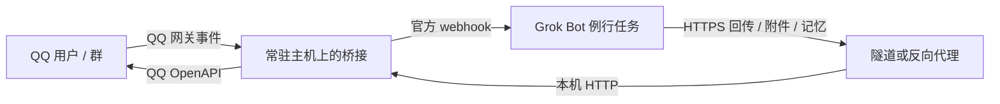

# QQ ⇄ Grok Bot 桥接

把 QQ 官方机器人的私聊和群内 @ 消息交给 Grok Bot 处理，支持文字、图片、对话历史和会话记忆。

推荐把桥接部署在持续在线的 Linux 主机上，Grok 云电脑只在 webhook 任务中处理消息并回传结果。Windows 可用于开发和前台测试，支持 x64/ARM64 Linux 常驻部署，不需要 GPU。版本与变更见 [CHANGELOG](CHANGELOG.md)。

## 交给 agent 部署

将 **[DEPLOY_AGENT.md](DEPLOY_AGENT.md)** 交给 Grok Bot、Codex 或其他有终端能力的 agent，提供运行主机、QQ 凭据、Grok webhook 和 HTTPS 回复入口，即可按文档完成安装与验证。支持直接在目标主机执行，也支持通过 SSH 部署。

复制以下指令并替换占位内容；密钥通过安全配置或文件提供，不粘贴进对话：

```text
请按仓库根目录 DEPLOY_AGENT.md 完成部署，并逐项报告验收结果。
仓库：https://github.com/XiaoMa3413/qq-grokbot-bridge
源码版本：main（也可指定已发布标签）
目标主机：<当前主机，或可访问的 SSH 地址>
公网回复地址：https://<域名>:<端口>/reply
QQ 与 Grok webhook 凭据：<已配置的凭据文件位置或安全凭据配置>
```

部署默认使用 `$HOME/projects/qq-grokbot-bridge` 和本机端口 `8787`，可按需调整。升级已有实例时，agent 会先检查配置和运行状态。

## 为什么分离部署

Grok 云电脑可能在无活动时暂停，后台脚本也会一起停止，仅使用 `nohup` 或进程守护无法维持 QQ 长连接。桥接放在持续在线的主机后，由该主机维护 QQ 连接，消息通过 Grok 平台 webhook 触发任务。平台的暂停行为见 [Grok Bot 官方支持说明](https://forum.cursor.com/t/grok-bot-computer-freezes-reboots-repeatedly-and-kills-24-7-background-scripts/174272)。



桥接主动连接 QQ WebSocket 网关，**QQ 收消息不需要公网回调**。公网 HTTPS 用于 Grok 回传及访问任务资源。Grok 云电脑上只需配置例行任务、固定回传地址和密钥，无需常驻 QQ 桥接进程。

可选安装 [Grok 云电脑轻量客户端](client/README.md)：只依赖 Python 3.10+，根据本次任务自动处理路由、分段序号、图片编码和文件上传，并输出请求耗时。它独立于服务端 Node 项目，无需升级云电脑旧仓库；不负责平台唤醒或模型生成，不承诺固定提速比例。

## 功能与边界

| 能力 | 行为 |
|---|---|
| 私聊、群内 @ | 转发正文、路由、历史、引用和可用图片给 Grok |
| 群内非 @ 消息 | 收到事件时只记录历史、缓存最近图片，不触发回复；是否收到取决于 QQ 权限与群设置 |
| 对话历史与记忆 | 私聊最多 20 条、群聊最多 10 条历史，关联完整问答并按身份/引用选择；每会话独立 Markdown 记忆，远程写入有并发校验 |
| 图片 | 入站图片提供鉴权下载；远程回图使用 `images_base64`，支持 PNG/JPEG |
| 文件与语音 | 最终回复支持普通文件、已生成的音频；大文件先流式上传再引用，实际 QQ 权限与播放需验收 |
| 持久化队列 | 远程模式先落盘再转发；同会话顺序处理，不同会话最多并行 4 个任务 |
| 重试与回调防重 | 明确连接前失败及 429 按时限重试；投递结果不明暂停重投；相同最终回调返回已保存结果 |
| 分段回复 | Grok 可先回“正在处理”，再发最终结果；每段有序号并独立防重，共享原消息配额和截止时间 |
| 运维 | `/health`、任务状态接口、心跳与断线恢复；Linux systemd 提供退出后重启 |

每个任务可先提交简短进度，最后提交**一次最终回复**。使用 `reply_seq:1, final:false` 发送第一段，成功后递增序号；最终段使用 `final:true`。未提供这两个字段的旧回调仍是一次最终回复。每个进度段只能有不超过 1500 字符的文字，至少给最终结果留一个名额。最终文字按 1500 字符拆分后再发图片。所有段的文字和图片共用配额：当前私聊最多 4 条、群聊最多 5 条。回图最多 5 张，解码后总大小不超过 5 MiB。

进度由 Grok 开始执行后主动回传，桥接不会在唤醒前自动代发确认；修改任务规则后才会使用分段能力。进度提示不占用正文历史条数。当前的[上下文机制](deploy/conversation-context.md)会关联问答，区分自身回复、外部作者与身份未知的群背景，并对历史、引用和最近群上下文应用总文字预算；任务追加要求与更完整的记忆管理仍见[后续设计](deploy/context-design.md)。

回复时限按原 QQ 消息计时：群聊 5 分钟、私聊 60 分钟，排队不会延长时限。Grok 执行慢、等待审批或配额不足仍可能导致到期。webhook 响应丢失、408/5xx 或发送时进程中断会标记投递 `uncertain`，暂停自动重投，核对远端后可用主机管理命令安排重投；发送 QQ 时中断也需核对结果，不自动重发。详细语义见 [投递恢复](deploy/forward-recovery.md) 和 [远程协议](deploy/remote-protocol.md)。

## 手动快速开始

准备 Git、Node.js **22.9+（推荐 22.x/24.x）**，以及：

- QQ 开放平台机器人 AppID、AppSecret 和私聊/群聊事件权限。
- 一个接收 JSON 的 Grok 官方 webhook 例行任务及其调用凭据。
- 一个转发到桥接主机 `127.0.0.1:8787` 的 HTTPS 回复入口，可使用反向代理或隧道服务。

项目使用 `ws` 和 `undici`，通过锁文件安装。npm 脚本依赖 `--env-file-if-exists`，该参数始于 Node.js 22.9，见 [Node.js CLI 文档](https://nodejs.org/api/cli.html#--env-file-if-existsfile)。

### 1. 下载与安装

```bash
git clone https://github.com/XiaoMa3413/qq-grokbot-bridge.git
cd qq-grokbot-bridge
npm ci
```

### 2. 填写配置

初始化项目配置和回复密钥，Linux 与 Windows 使用同一命令：

```bash
npm run setup
```

命令创建缺失的 `.env` 和 `reply_token`，可重复执行，保留已有配置与密钥。也可在新安装时通过 `npm run setup -- --from .env.import` 从凭据文件导入 QQ/Grok 配置；已有 `.env` 时跳过导入。

编辑 `.env`，填写：

```dotenv
QQ_APP_ID=<QQ AppID>
QQ_APP_SECRET=<QQ AppSecret>
QQ_FORWARD_WEBHOOK_URL=<Grok 官方 webhook 地址>
QQ_FORWARD_WEBHOOK_SECRET=<webhook 密钥；任务无鉴权时可留空>
QQ_REPLY_PORT=8787
QQ_REPLY_PUBLIC_URL=https://<域名>:<端口>/reply
```

将占位符替换为平台提供的值。Linux 上设置 `.env` 权限为 `600`。HTTPS 入口的具体配置可参考 [Sakura FRP 示例](deploy/sakura-frp.md)，也可使用其他支持 HTTPS 的隧道或反向代理。

### 3. 配置 Grok 回复

完成配置后，先运行本地检查：

```bash
npm run doctor -- --remote
```

默认密钥已由 `setup` 保存到项目根目录 `reply_token`；如果 `.env` 已设置 `QQ_REPLY_TOKEN`，使用该固定值。通过安全凭据配置将同一个值提供给 Grok 执行环境，并设置 `QQ_REPLY_URL` 等于桥接的 `QQ_REPLY_PUBLIC_URL`。

将 [Grok 任务规则](DEPLOY_AGENT.md#可复制到-grok-例行任务的规则) 复制到 webhook 例行任务。任务使用固定地址和密钥回传回复，支持图文、文件/语音及会话记忆。语音生成与发送分开，桥接不内置 TTS；文件权限及音频格式需按当前机器人验收。

### 4. 启动与验证

如果运行了探测服务，先停止它，确保端口空闲。启动桥接：

```bash
npm start
```

在另一个终端进入同一项目目录，检查连接：

```bash
npm run status
npm run doctor -- --remote --live
```

`npm start` 从项目 `.env` 加载配置并前台运行。长期部署请按 [agent 部署指南](DEPLOY_AGENT.md) 安装 systemd 用户服务；修改服务模板中的项目目录和 Node 绝对路径，并检查用户 linger。Windows 关闭前台终端后会停止，仓库目前未提供 Windows 开机服务安装器。

状态返回 `ok: true` 后，私聊机器人或在已授权的群内 @机器人发送一条消息，确认 Grok 任务被触发并在 QQ 收到回复。沙箱机器人需先配置测试用户和群。

如果只想让 Grok 与桥接在同一台机器上运行，可以不设置 `QQ_REPLY_PUBLIC_URL`，回传到 `http://127.0.0.1:8787/reply`。这使用本机模式，支持本地图片路径和 `memory_path`，**没有远程模式的持久化任务与回调防重**；主机休眠时连接仍会中断。

## 配置参考

| 变量 | 说明 |
|---|---|
| `QQ_APP_ID`、`QQ_APP_SECRET` | 必填，QQ 机器人凭据 |
| `QQ_FORWARD_WEBHOOK_URL` | Grok webhook；未设置时只记录消息、不转发 |
| `QQ_FORWARD_WEBHOOK_SECRET` | 默认作为 `Authorization: Bearer ...` 发送 |
| `QQ_FORWARD_WEBHOOK_HEADER` | 仅原 webhook 使用自定义鉴权头时设置；直接传密钥原值 |
| `QQ_REPLY_PORT` | 本机端口，默认 `8787` |
| `QQ_REPLY_PUBLIC_URL` | 完整 HTTPS `/reply` 地址；设置后启用持久化远程模式；禁止查询参数、片段和 URL 内凭据 |
| `QQ_REPLY_TOKEN` | 可选，至少 32 字符；不设置时读取或生成 `reply_token`。不要设置为空字符串 |
| `QQ_REPLY_URL` | **回复客户端/Grok 执行环境**的固定目标地址，不是桥接服务器的监听配置 |
| `QQ_JOBS_DIR` | 远程任务目录，默认 `data/jobs`，禁止多个桥接进程共用 |
| `QQ_HISTORY_DIR`、`QQ_MEMORY_DIR`、`QQ_MEDIA_DIR` | 覆盖对应数据目录 |
| `QQ_KNOWLEDGE_DIR` | 角色与选定事实目录，默认 `data/knowledge`；本地管理命令与桥接使用同一目录 |
| `QQ_HTTP_TIMEOUT_MS` | 出站 HTTP 超时，默认 `15000` 毫秒 |
| `QQ_READY_TIMEOUT_MS`、`QQ_LIVENESS_MAX_AGE_MS` | 启动等待和存活检查时限，默认 `60000` / `90000` 毫秒 |
| `QQ_DEBUG_RAW_EVENTS` | `1` 时保存调试事件；仍可能包含会话隐私 |

`config.json` 配置监听地址、QQ API、事件 intents 和历史条数。监听地址由 `replyHost` 设置，默认 `127.0.0.1`。`historyLimitC2c` / `historyLimitGroup` 是上下文历史条数上限（整数 1–1000），完整问答可能让实际返回条数少于上限。`contextTextMaxChars` 默认 `12000`（整数 256–65536），约束历史、引用和最近群上下文的文字总长度；不含当前消息、独立记忆、附件及元数据，不是模型 token 或整个 JSON 大小限制。不要把真实凭据写入版本库。

QQ群内的消息获取范围由 QQ 设置决定，与上述历史条数独立。缺少发言者 ID 的近期背景保持身份未知；昵称和 `is_bot:true` 均不能证明消息是本机器人所说。升级到 1.9 后还需同步 [Grok 规则](DEPLOY_AGENT.md#可复制到-grok-例行任务的规则)，才能让模型按新归属字段处理上下文。

QQ 机器人需具备相应私聊/群聊事件权限。沙箱机器人还需把测试用户和群加入沙箱名单。项目面向被动回复，远程接口要求已登记消息的原始路由，不将过期任务改为主动推送。

配置在启动时读取并校验，历史存储、上下文组装和回复记录共用同一份设置；修改 `config.json` 或环境变量后需重启服务生效。

## 常用操作

角色和选定长期事实可按单个私聊或群聊导入，先预览再提交，保留来源、版本与删除标记；QQ 任务只读使用固定快照。使用方法与限制见[角色与选定事实导入](deploy/knowledge-import.md)。它与现有会话 Markdown 记忆并存，不自动同步平台记忆。

| 操作 | 命令 / 入口 |
|---|---|
| 初始化配置 | `npm run setup`；新安装可用 `-- --from .env.import` 导入凭据文件 |
| 启动前诊断 | `npm run doctor -- --remote`；本机模式可省略 `--remote` |
| 查询运行状态 | `npm run doctor -- --live`，只请求本机 `/health` |
| agent 诊断 | `npm run --silent doctor -- --remote --json`，返回 JSON 和退出码 |
| 本地测试 | `npm test`，使用临时目录和模拟 QQ/webhook，不需要真实凭据 |
| 仅测隧道 | `npm run probe`，不连接 QQ；不能与真实桥接占用同一端口 |
| 查看健康 | `npm run status`；`GET /health` 不健康时返回 503 |
| 诊断与人工重投 | `npm run jobs -- list` / `show --job <job_id>`；停止服务后按[恢复流程](deploy/forward-recovery.md)执行 `retry` |
| 查看服务日志 | `journalctl --user -u qq-grokbot-bridge -f` |
| 启动 Linux 服务 | `systemctl --user start qq-grokbot-bridge`，停止或重启使用 `stop` / `restart` |
| 远程回传 | 使用 HTTP 工具，或配置 `QQ_REPLY_URL` / `QQ_REPLY_TOKEN` 后运行 `npm run reply`，JSON 从 stdin 输入 |
| 上传回复附件 | Grok 执行环境运行 `npm run upload-media -- --job <job_id> --kind file --file ./report.pdf`；返回引用供最终回复使用，详见[文件与语音](deploy/file-voice.md) |

`doctor` 默认只读本地文件，不生成密钥、不连接 QQ 或 Grok。`--live` 额外查询本机健康接口；`--remote` 要求启用远程模式。存在 `FAIL` 时退出码为 1，只有 `PASS` / `WARN` 时为 0。检查通过代表本地配置满足条件，实际凭据有效性和公网连通性仍需通过收发测试验证。初始化和诊断命令适用于当前源码，使用旧标签时按该标签自带的说明部署。

远程 `POST /reply` 的最小请求如下，需 `Content-Type: application/json` 和 `X-Reply-Token` 请求头：

```json
{
  "job_id": "<原任务ID>",
  "type": "c2c",
  "openid": "<原用户ID>",
  "msg_id": "<原消息ID>",
  "content": "最终回复"
}
```

群聊使用 `type: "group"` 和 `group_openid`。只有 HTTP 2xx 且 JSON `ok: true` 才算成功；部分发送失败、409 或 410 时不要盲目重试。图片和记忆请求示例见 [远程协议](deploy/remote-protocol.md)。

## 数据、测试与版本

运行数据位于 `data/history/`、`data/media/`、`data/jobs/`、`data/knowledge/`、`memory/` 和 `logs/`；systemd 的标准输出由 journal 保存。`.env`、`reply_token` 及运行数据已被 Git 忽略，仍应限制访问并单独备份。任务默认保留至截止时间后 7 天、最多 10,000 项；入站媒体缓存目前不自动清理。

文件/语音的出站上传保存在 `<QQ_JOBS_DIR>/outbound/`，随任务保留期清理，备份时包含整个队列目录。该清理不涵盖旧的入站 `data/media/` 缓存。单文件桥接上限 100 MiB、语音 20 MiB；公网入口需允许 100 MiB 二进制请求。小文件可用 `media_base64`，与图片共用 5 MiB 内联限制。具体协议、权限和配额见[文件与语音](deploy/file-voice.md)。

`npm test` 覆盖事件解析、历史、鉴权、图片、记忆并发、任务恢复、防重及模拟服务集成。首次部署还需通过 QQ 发送实际消息，确认 Grok 任务执行并成功回传；完整验收步骤见 [部署指南](DEPLOY_AGENT.md#7-按阶段验收)。

[自动测试](.github/workflows/test.yml) 在 PR 和 main 更新时运行 Node.js 22/24、Windows/Linux 四组检查，也可在 GitHub Actions 页面手动触发。每组执行 `npm ci` 和 `npm test`，无需配置 QQ 或 Grok 凭据。功能版本使用 Git 标签固定，升级前备份并等待在途任务完成，不直接覆盖运行目录中的配置或数据。

| 文档 | 内容 |
|---|---|
| [交给 agent 部署](DEPLOY_AGENT.md) | 完整安装、迁移和验收流程 |
| [Grok 任务配置](deploy/grok-routine.md) | 凭据迁移及可复制的例行任务规则 |
| [远程协议](deploy/remote-protocol.md) | 任务、图片、记忆、错误码及恢复语义 |
| [投递诊断与人工重投](deploy/forward-recovery.md) | 结果不明分类、只读诊断、版本检查与主机重投流程 |
| [文件发送与语音回复](deploy/file-voice.md) | 内联/流式回传、分片上传、TTS 边界、权限与真实验收 |
| [角色与选定事实导入](deploy/knowledge-import.md) | 按会话预览/提交、来源版本、删除与任务只读快照 |
| [Sakura FRP 部署示例](deploy/sakura-frp.md) | 通用隧道设置与连通性验证 |
| [版本与回退](deploy/releases.md) | 发布、升级、备份和回退 |
| [同类项目代码调研](docs/research/bridge-comparison.md) | 进度反馈、投递语义、角色和记忆设计的对照与实施建议 |
| [更新记录](CHANGELOG.md) | 各版本变更 |
