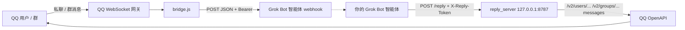

# Grok Bot ⇄ QQ 官方机器人桥接

一个 Node.js 小程序，把 QQ 官方机器人（API v2）收到的消息转给你的 Grok Bot 智能体。智能体通过本地回复接口把回复发回 QQ。

- **入站**：QQ WebSocket 网关 → 本程序 → POST 到 Grok Bot 智能体的 webhook
- **出站**：智能体 → `POST http://127.0.0.1:8787/reply` → 本程序 → QQ OpenAPI



## 功能

- **私聊（C2C）**：处理 `C2C_MESSAGE_CREATE` 事件。
- **群聊被 @ 时响应**：处理 `GROUP_AT_MESSAGE_CREATE` 事件，载荷里的 `at` 为 `true`。
- **群内非 @ 消息（`GROUP_MESSAGE_CREATE`）**：只记录、不打扰。需要在 QQ 群的机器人设置里开启「获取@机器人的最近10条消息」后才会推送；收到后先按 `msg_id` 去重（与被 @ 的消息共用同一张去重表），再下载图片附件、写入该群的对话历史，**不转发**给智能体、**不回复**。其中最近 10 分钟内的图片会进入一个群内缓存（最多 5 张，按时间升序），之后有人 @ 机器人时随 `recent_images` 一起转发。
- **其他事件**：不认识的事件类型只在日志里记一行类型名，不解析、不转发。
- **对话历史**：每个会话（私聊按 openid，群按 group_openid）保存为 JSONL 文件。转发时附带该类型会话最近的若干条记录（`history` 字段），不含当前这条；默认私聊最近 20 条、群聊最近 10 条。文件条数超过「上限 + 10」时裁剪回上限（私聊超过 30 条裁到 20 条，群聊超过 20 条裁到 10 条），每条内容最多保留 2000 字符。上限可在 `config.json` 中用 `historyLimitC2c` / `historyLimitGroup` 配置。机器人发出的回复也会写入历史。
- **会话记忆文件**：每个会话有一个 Markdown 文件，不存在时自动创建为空文件，路径通过 `memory_path` 交给智能体。桥接本身不读也不写其中内容，由智能体自行维护。
- **图片附件**：`image/*` 附件会下载到本地（单张上限 20 MB，超时 15 秒），成功后在附件上写入 `local_path`（绝对路径），失败则为 `null`。下载失败不影响消息转发。
- **长回复拆分**：超过 1500 字符的回复按段落（`\n\n`）、换行、硬切的优先级拆成多条。
- **遵守 QQ 被动回复限制**：同一 `msg_id` 下，私聊最多 4 条、群聊最多 5 条；不带 `msg_id` 的主动消息单次最多 5 条。超出部分会截断，最后一条末尾加上 `…（内容过长，已截断）`。`msg_seq` 自动递增。
- **断线重连**：支持心跳、Resume 和指数退避重连（上限 60 秒）。access token 到期前自动刷新。webhook 转发失败最多重试 3 次。

## 环境要求

- Node.js 18 及以上（使用内置 `fetch`）
- 依赖：`ws`（运行 `npm install` 安装）
- 回复脚本 `reply.sh` 需要 `bash` 和 `curl`
- 一个 QQ 开放平台机器人，以及一个能接收 webhook 的 Grok Bot 智能体

## 环境变量

| 变量 | 必需 | 说明 |
|---|---|---|
| `QQ_APP_ID` | 是 | 机器人 AppID |
| `QQ_APP_SECRET` | 是 | 机器人 AppSecret |
| `QQ_FORWARD_WEBHOOK_URL` | 建议 | Grok Bot 智能体的 webhook 地址，会覆盖 `config.json` 里的 `forwardWebhookUrl`。不设置时消息只记日志、不转发 |
| `QQ_FORWARD_WEBHOOK_SECRET` | 否 | 设置后，转发请求带上 `Authorization: Bearer <secret>` |
| `QQ_FORWARD_WEBHOOK_HEADER` | 否 | 改用其他请求头名传 secret（此时直接传原值，不加 `Bearer`） |
| `QQ_REPLY_PORT` | 否 | 回复接口端口，默认 8787 |
| `QQ_API_BASE` / `QQ_TOKEN_URL` | 否 | 覆盖 OpenAPI 地址和取 token 的地址 |
| `QQ_HISTORY_DIR` / `QQ_MEMORY_DIR` / `QQ_MEDIA_DIR` | 否 | 覆盖数据目录 |
| `QQ_DEBUG_RAW_EVENTS` | 否 | 设为 `1` 时，把原始事件追加写入 `logs/raw-events.jsonl`（已脱敏，见「调试」） |

缺少 `QQ_APP_ID` 或 `QQ_APP_SECRET` 时，进程以退出码 78 退出，守护脚本收到后也会停止。

## config.json

```json
{
  "forwardWebhookUrl": "",
  "replyHost": "127.0.0.1",
  "replyPort": 8787,
  "apiBase": "https://api.sgroup.qq.com",
  "tokenUrl": "https://bots.qq.com/app/getAppAccessToken",
  "intents": 33554432,
  "historyLimitC2c": 20,
  "historyLimitGroup": 10
}
```

`intents` 为 `1<<25`（GROUP_AND_C2C_EVENT）。`replyHost` 建议保持 `127.0.0.1`，不要对外暴露。

`historyLimitC2c` / `historyLimitGroup`：转发时附带的对话历史条数上限，默认 20 / 10（缺省或非法值时回退到默认值）。历史文件超过「上限 + 10」条时裁剪回上限条。

## QQ 开放平台设置

1. 在 QQ 开放平台创建机器人，拿到 AppID 和 AppSecret。
2. 启用单聊和群聊能力，确保有 `GROUP_AND_C2C_EVENT`（`1<<25`）事件权限。
3. 本程序使用 WebSocket 网关，不需要配置公网回调地址。
4. **沙箱阶段**：机器人上线前，只有加入沙箱配置的 QQ 号和群才能收到、发出消息。在群里 @ 了机器人却没有反应时，先检查这个群是否在沙箱群列表里，再检查成员是否在白名单里。
5. **群内非 @ 消息**：在群的机器人设置里开启「获取@机器人的最近10条消息」，`GROUP_MESSAGE_CREATE` 才会推送过来。这类消息只记历史、不回复，同样受沙箱限制。

## 启动与停止

```bash
npm install
export QQ_APP_ID=... QQ_APP_SECRET=...
export QQ_FORWARD_WEBHOOK_URL=... QQ_FORWARD_WEBHOOK_SECRET=...
mkdir -p logs
./start.sh   # 后台启动守护进程 run_loop.sh，PID 写入 run.pid
./stop.sh    # 结束整个进程组
```

- `run_loop.sh` 在 `bridge.js` 崩溃后自动重启，等待时间从 2 秒开始翻倍，最多 60 秒；连续运行超过 60 秒后重置为 2 秒。
- 日志：`logs/bridge.log`、`logs/supervisor.log`。
- 健康检查：`GET http://127.0.0.1:8787/health` → `{"ok":true}`

### 调试

```bash
QQ_DEBUG_RAW_EVENTS=1 ./start.sh
```

设为 `1` 时，除 `READY` / `RESUMED` 之外的每个网关事件都会以 `{t, d}` 追加写入 `logs/raw-events.jsonl`，用来和 QQ 文档逐字段核对事件结构。写入前会做一次脱敏：任意层级的键名只要匹配 `token` 或 `secret`（不区分大小写），整个字段都会被丢掉。`logs/` 已在 `.gitignore` 中排除，这个文件只留在本地，不要提交。

## Webhook 转发格式

```json
{
  "type": "c2c",
  "openid": "<user_openid>",
  "author": { "id": "...", "username": "...", "user_openid": "...", "member_openid": "...", "member_role": "...", "union_openid": "..." },
  "nickname": "<author.username>",
  "group_card": null,
  "content": "消息文本（已 trim）",
  "quoted": [ { "author": "amy", "content": "被引用的内容", "attachments": [ { "content_type": "image/png", "url": "...", "local_path": "/abs/path/data/media/<msg_id>-0.png" } ] } ],
  "msg_id": "<QQ 消息 id>",
  "timestamp": "...",
  "attachments": [ { "content_type": "image/png", "url": "...", "local_path": "/abs/path/data/media/<msg_id>-0.png" } ],
  "message_type": 0,
  "ref_msg_idx": "<message_scene.ext 里的 ref_msg_idx>",
  "memory_path": "/abs/path/memory/c2c-<openid>.md",
  "history": [ { "role": "user|bot", "nickname": "...", "member_role": null, "openid": "...", "content": "...", "timestamp": "..." } ]
}
```

群消息的 `type` 为 `"group"`，用 `group_openid` 代替 `openid`，另外多两个字段：`at`（是否 @ 了机器人）和 `recent_images`（群里最近的非 @ 图片）。`author` 保留 QQ 事件里的原始字段。QQ v2 事件一般不提供群名片，所以 `group_card` 通常为 `null`。

### 载荷字段

| 字段 | 类型 | 说明 |
|---|---|---|
| `at` | bool | 群消息是否 @ 了机器人：`GROUP_AT_MESSAGE_CREATE` 为 `true`，`GROUP_MESSAGE_CREATE` 为 `false`；私聊载荷没有这个字段 |
| `quoted` | array | 从 `msg_elements` 递归解析出来的引用/聊天记录，每项 `{ author, content, attachments }`；`message_type` 为 103（引用）或 102（聊天记录）的嵌套元素也会一并收进来 |
| `message_type` | number \| null | 原始事件的 `message_type`，缺失时为 `null` |
| `ref_msg_idx` | string \| null | 取自 `message_scene.ext` 里的 `ref_msg_idx=...`，没有则为 `null` |
| `recent_images` | array | 该群最近 10 分钟内「非 @ 消息」里的图片，最多 5 张，按时间升序，每项 `{ local_path, nickname, timestamp }`；出现在被 @ 的群消息载荷上（没有缓存时为 `[]`），私聊载荷没有这个字段 |

## 回复接口

`POST http://127.0.0.1:8787/reply`，请求头 `X-Reply-Token: <reply_token 文件内容>`。

```json
{ "type": "c2c", "openid": "<openid>", "msg_id": "<被回复的 msg_id，可选>", "content": "回复文本" }
```

群聊用 `"type": "group"` 和 `"group_openid"`。带上 `msg_id` 就是被动回复；不带则为主动消息，会受 QQ 主动消息配额限制。

### 发送图片

可以在请求里加 `image`（单个本地绝对路径）或 `images`（路径数组），文字 `content` 可选，图文可以同时发：

```json
{ "type": "group", "group_openid": "<group_openid>", "msg_id": "<msg_id>",
  "content": "今天的简报", "images": ["/abs/path/briefing.png"] }
```

```bash
curl -sS -X POST http://127.0.0.1:8787/reply \
  -H 'Content-Type: application/json' -H "X-Reply-Token: $(cat reply_token)" \
  -d '{"type":"c2c","openid":"<openid>","msg_id":"<msg_id>","content":"看图","image":"/abs/path/a.png"}'
```

- 流程：先调用 `POST /v2/users/{openid}/files` 或 `/v2/groups/{group_openid}/files`（`file_type: 1`，`file_data` 为 base64，`srv_send_msg: false`）拿到 `file_info`，再发 `msg_type: 7` 的消息（`media.file_info`），带同一个 `msg_id` 和递增的 `msg_seq`。
- 发送顺序：先发文字（按原规则分段），再逐张发图片。每张图片占一条消息配额，与文字共用被动回复上限（私聊 4 条、群聊 5 条 / msg_id；主动消息 5 条）；超出部分不发送，在响应里记为 `images_skipped`。
- 校验（不通过返回 400，且什么都不发）：必须是绝对路径、文件存在、扩展名为 `.png`/`.jpg`/`.jpeg`、内容确实是 PNG/JPEG、大小不超过 5 MB（QQ 二进制直传上限）。
- 带图片的请求，响应额外包含 `images_sent`、`images_total`、`images_skipped`；纯文字请求的响应格式不变。
- 聊天记录里图片记为 `[图片] 文件名`。

响应：

```json
{ "ok": true, "parts_sent": 1, "parts_total": 1, "truncated": false, "result": { }, "results": [ ] }
```

| 状态码 | 含义 |
|---|---|
| 401 | token 错误 |
| 400 | JSON 无效或缺少字段 |
| 502 | QQ API 报错（带 `error`、`detail`，以及已发送的条数） |

命令行写法：

```bash
./reply.sh c2c <openid> <msg_id|-> 回复内容
./reply.sh group <group_openid> <msg_id|-> 回复内容
IMAGE=/abs/path/a.png ./reply.sh c2c <openid> <msg_id|-> [文字|-]   # 附带一张图片
```

`reply_token` 在首次启动时随机生成，文件权限为 600。

## 数据目录

| 路径 | 内容 |
|---|---|
| `data/history/<type>-<id>.jsonl` | 对话历史 |
| `data/media/<msg_id>-<n>.<ext>` | 下载的图片 |
| `memory/<type>-<id>.md` | 会话记忆，由智能体维护 |
| `logs/` | 运行日志和调试用的原始事件 |

以上目录、`reply_token` 和 `run.pid` 都已在 `.gitignore` 中排除。

## 测试

```bash
node test/test.js
```

一条命令跑两套测试：`test/test.js` 会先加载 `test/events.test.js`（事件解析、去重表、最近图片缓存、脱敏），再执行下面的主测试；任一断言失败都会以非 0 退出码结束。

测试使用临时目录和本地模拟服务器，覆盖事件转换、token 刷新、回复接口（鉴权、拆分、被动回复上限、截断）、历史记录、记忆路径和图片下载，不需要真实的 QQ 凭据。

## 安全

- AppID、AppSecret 和 webhook secret 只通过环境变量传入，不要写进文件或提交到仓库。
- 回复接口只监听 `127.0.0.1`，并用 `X-Reply-Token` 鉴权。
- 日志不会输出密钥；取 token 失败时只记录错误码和错误信息。
- 历史、记忆和图片文件可能包含用户隐私，请妥善保管，并按需清理。
